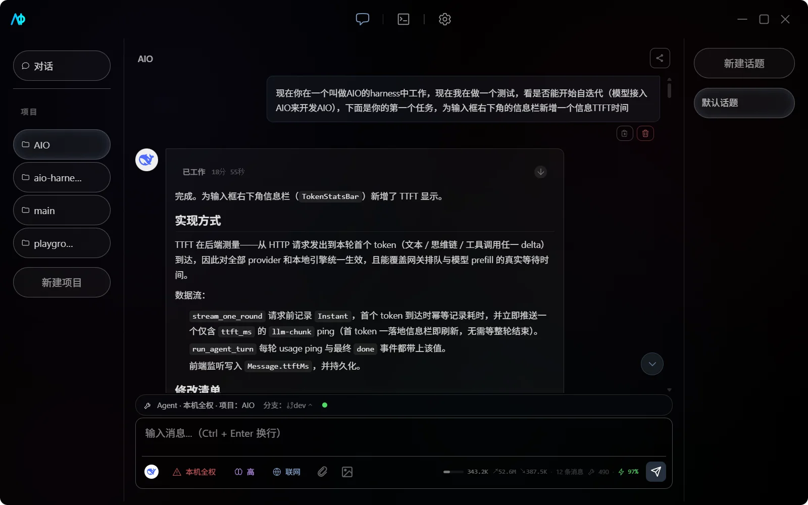

<div align="center">
  
  <h1>AIO (All-In-One AI)</h1>
  <p>
    <strong>一个轻量、跨平台，兼顾日常对话与代码 Agent 的 AI 桌面工作区</strong><br>
    <em>A lightweight, cross-platform AI workspace for chat and coding agents.</em>
  </p>

  <p>
    
    
    
    
  </p>
</div>

[English](README.md) | **简体中文**

---



---

## 🌟 核心特性 | Features

### 1. 💬 多模型对话 | Multi-Provider Chat

- **多厂商接入**：支持 Google、Anthropic、Ollama 与 OpenAI-compatible API。
- **灵活模型管理**：按 Provider 启用模型，为不同助手和子智能体选择专属模型。
- **完整对话体验**：流式输出、推理内容、上下文压缩、自动标题与消息分支一应俱全。
- **项目记忆**：按项目沉淀事实，对话与代码混合检索（RAG），嵌入与重排模型全部本地运行。

### 2. 🧠 本地模型推理 | Local LLM

- **llama.cpp 驱动**：直接选择并运行本地 GGUF 模型。
- **首次自动安装**：缺少运行引擎时，AIO 会在启动模型时自动下载。
- **模型市场**：从 HuggingFace / ModelScope 搜索并下载 GGUF 模型，附带硬件适配推荐。
- **统一体验**：本地模型与远程模型共用助手、话题和模型选择器。

> [!NOTE]
> vLLM 插件已在 Rust 后端注册，但当前设置界面只开放 llama.cpp。普通用户请使用 GGUF 模型。

### 3. 🛠️ 项目 Agent | Coding Agent

- **五档 Agent 模式**：只读、工作区内修改、完全权限、Plan 与本机全权，按任务风险切换；高档位进入前有明确的风险确认。
- **项目级工具**：文件、Shell、Git、LSP、联网搜索、MCP 和 Skill 都能围绕当前目录协作。
- **子智能体协作**：内置探索、实现、架构、诊断、审查、文档、测试等专业角色，支持自定义角色；实时流式输出，git worktree 隔离写入。
- **安全审批**：危险命令、文件修改和 MCP 工具调用遵循项目权限规则。

### 4. 🖥️ Harness 工作台 | CLI Agent Workbench

- **一个图形界面驱动 CLI 编码工具**：在 AIO 内使用 Claude Code、Codex、OpenCode、Oh My Pi、Gemini CLI、Qwen Code、goose 与 DSH（Agent Client Protocol，Claude Code / Codex 另有原生驱动）。
- **原生渲染**：思维链、工具调用、文件 Diff 与审批请求以 AIO 原生界面呈现；会话按工作区持久化，重启后可续。
- **工具自己的配置即事实源**：凭据存系统钥匙串；高频配置提供结构化表单；原始配置文件带格式校验与备份编辑。

### 5. 📚 文件与扩展 | Files & Extensions

- **常用文件解析**：支持图片、PDF、DOCX、PPTX 和多种文本格式。
- **MCP 生态**：支持 stdio、HTTP、Streamable HTTP、Catalog、Tools、Resources 与 Prompts。
- **Skill 管理**：可从市场下载，也可导入 NPX Skill，并按全局或项目范围启用。

### 6. ✨ 贴心体验 | Productivity

- **快捷操作**：命令面板、可定制快捷键和 `/review`、`/fix`、`/btw` 等斜杠命令。
- **会话分享**：导出截图、Markdown、JSON 或 PDF。
- **用量统计**：查看 Token 汇总、模型分布和使用热力图。
- **反馈与诊断**：复制环境快照、一键打开预填 GitHub issue、导出诊断包——不含 API Key 与会话内容。
- **自动更新**：通过 GitHub Releases 获取跨平台更新。

---

## ⚙️ 技术栈 | Tech Stack

| 层级         | 技术                                        |
| ------------ | ------------------------------------------- |
| Frontend     | SolidJS 1.9、TypeScript、Tailwind CSS、Vite |
| Desktop      | Tauri 2.11                                  |
| Backend      | Rust、Tokio、Reqwest                        |
| Storage      | SQLite、JSON 配置、系统凭据库               |
| Local Engine | llama.cpp；vLLM 后端插件                    |

---

## 🚀 快速开始 | Getting Started

### 📦 下载发行版 | Download

前往 [GitHub Releases](https://github.com/Atom112/AIO/releases)，下载适合当前系统的安装包。发布流程覆盖 Windows、Ubuntu 22.04，以及 Apple Silicon macOS（Intel macOS 构建止于 v0.8.0）。

> [!NOTE]
> 预发布版本（例如 `v1.0.0-alpha`）同样发布在 Releases 页面，但不会通过应用内更新推送——想尝鲜请手动下载。

安装后打开"设置 → 供应商设置"：

1. 配置远程 Provider，或在"本地推理引擎"中选择 GGUF 模型；
2. 启用模型并返回聊天页；
3. 选择模型，开始第一段对话。

想让 AI 参与代码工作？创建项目、绑定本地目录，再切换到工作区内修改、完全权限或 Plan 模式。想继续用自己的 CLI 工具？打开 Harness 工作台接入即可。

### 🏗️ 从源码运行 | Build from Source

需要 Node.js 20、Rust stable、当前平台的 [Tauri 2 系统依赖](https://v2.tauri.app/start/prerequisites/)，以及与本仓库同级的 `aio-models-data`：

```text
parent/
├── AIO/
└── aio-models-data/
```

```bash
git clone https://github.com/Atom112/aio-models-data.git
git clone https://github.com/Atom112/AIO.git
cd AIO
npm ci
npm run tauri dev
```

构建前检查：

```bash
npm run build
cd src-tauri
cargo check
```

> [!TIP]
> Linux 依赖、发布构建和模型目录说明都整理在[开发环境文档](docs/zh/development/getting-started.md)中。

---

## 📖 文档导航 | Documentation

| 想了解什么                   | 从这里开始                                                      |
| ---------------------------- | --------------------------------------------------------------- |
| 安装、首次配置与第一次对话   | [快速开始](docs/zh/usage/getting-started.md)                    |
| Provider 与本地模型          | [供应商与模型](docs/zh/usage/providers-and-models.md)           |
| 助手、项目、Agent 与子智能体 | [聊天与 Agent](docs/zh/usage/chat-and-agent.md)                 |
| 驱动 CLI 编码工具            | [Harness 工作台](docs/zh/usage/harness.md)                      |
| MCP、Skill 与工具权限        | [MCP 与 Skill](docs/zh/usage/mcp-and-skills.md)                 |
| 主题、更新与快捷键           | [应用设置与快捷键](docs/zh/usage/app-settings-and-shortcuts.md) |
| 架构与扩展开发               | [开发指南](docs/zh/README.md#开发指南)                          |
| 连接、引擎或构建问题         | [故障排查](docs/zh/troubleshooting.md)                          |

完整目录见 [AIO 文档中心](docs/zh/README.md)，版本变化见 [CHANGELOG.md](CHANGELOG.md)。

---

## 📝 反馈与社区 | Feedback & Community

| 渠道                                                                 | 用途                                                                   |
| -------------------------------------------------------------------- | ---------------------------------------------------------------------- |
| [🐛 Issue Forms](https://github.com/Atom112/AIO/issues/new/choose)   | 结构化提交 Bug / 功能建议 / Alpha 体验反馈                             |
| [💬 Discussions](https://github.com/Atom112/AIO/discussions)         | 提问、想法与开放讨论（Q&A 与功能投票）                                 |
| [应用内反馈](docs/zh/usage/app-settings-and-shortcuts.md#反馈与支持) | 设置 → 应用 → 「反馈与支持」：复制环境快照、打开预填 issue、导出诊断包 |
| 中文用户交流群（QQ 群）                                              | 群号 **1130943633** — 中文交流与反馈，不方便上 GitHub 时走这里         |

> 应用内「环境快照」与诊断包**不含 API Key 与会话内容**，由你自己粘贴/上传到 GitHub；不经任何网络上传。

---

## 🤝 贡献 | Contributing

欢迎参与开发！流程规范（issue / 分支 / 提交 / PR）见[贡献指南](CONTRIBUTING.md)，编码规范见 [AGENTS.md](AGENTS.md)——人类与 AI 代理同一套标准。安全漏洞请按 [SECURITY.md](SECURITY.md) 私密报告。

- Pull Request 提交前请运行 `npm run verify` 与相关测试；
- 文档为双语镜像（`docs/zh/` 与 `docs/en/`），行为变更需双侧同步；
- 提交信息遵循 Conventional Commits。

---

<div align="center">
  <p>如果 AIO 对你有帮助，欢迎点亮一个 ⭐！</p>
  <p><em>If AIO helps you, a star would mean a lot.</em></p>
  <p>
    <a href="./LICENSE">Apache-2.0 License</a>
    ·
    <a href="https://github.com/Atom112">Atom112</a>
  </p>
</div>
