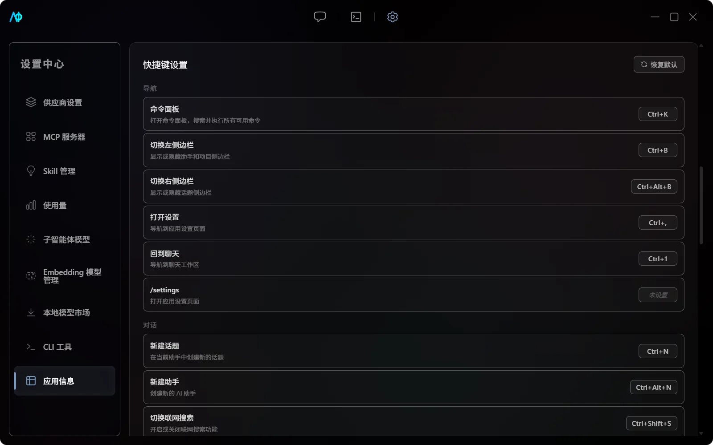

# App Settings and Shortcuts

"Settings -> App Settings" centrally manages app state, visual theme, and keyboard shortcuts. Provider, MCP, Skill, usage, and sub-agent model settings are located on separate pages in the settings sidebar.

## Interface Language

AIO supports Simplified Chinese (`zh-CN`) and English (`en-US`). On first launch, the system language is read: if the system language starts with `zh`, Simplified Chinese is used; otherwise, English is used. You can switch at any time under "App Settings -> Language". Already open pages update immediately, and no restart is required.

The selection is stored in the WebView `localStorage` under `aio-locale`; it is not written to app configuration, SQLite, the system credential store, or the project's `.aio/`. Clearing this key causes AIO to follow the system language again on next launch. User messages, model and provider names, MCP/Skill external descriptions, file contents, and command output always remain in the original language.

## App State

### Auto-start

When "Auto-start" is enabled, AIO registers a system startup entry for the current user; disabling it removes the entry. Windows, macOS, and Linux use their respective platform mechanisms. If the setting fails, the UI reverts to its previous state.

Auto-start is not the same as "Local Model Auto-start Confirmation": the former controls whether AIO starts with the system, while the latter only records whether the user has confirmed starting the llama.cpp process after selecting a local model.

### Project Memory (RAG)

Project-level memory (semantic RAG) is enabled in the project settings dialog (replacing the old global "Cross-Session Memory" toggle). Once enabled, the Agent gets memory tools such as `remember` / `recall` / `search_memory` / `update_memory` / `forget_memory`; facts are written to `.aio/memory/memory.sqlite` (vector + keyword hybrid retrieval) and relevant memory is auto-injected into later conversations.

A legacy `.aio/knowledge.json` is automatically migrated into facts the first time project memory is opened; the old file is kept afterwards and can be deleted manually.

> [!IMPORTANT]
> Project memory content may contain internal architecture or business information. Review `.aio/` before committing to version control.

### Version Updates

"Check for Updates" reads the updater metadata from GitHub Releases and distinguishes the following outcomes:

- Already up to date;
- New version found;
- Current release does not provide update service;
- Network error;
- Other check failure.

When an update is found, the app displays the version, release notes, and a download entry in the lower left corner. Official update packages must match the app's embedded public key; locally built installation packages are not equivalent to official releases.

Prereleases (for example `v1.0.0-alpha`) are never offered through the updater; download them manually from the Releases page.

## Feedback and Support

The bottom of "Settings -> App Settings" hosts the feedback area:

- **Environment snapshot**: a single line with version, OS, architecture, locale, RAM, detected CLI tools, and engine versions. Click to copy — it never contains API keys or conversation content.
- **GitHub channels**: "Report a Bug" opens the bug form with the snapshot pre-copied to the clipboard; "Alpha Feedback" and "Feature Request" open their forms; "Join Discussions" opens Discussions.
- **Export diagnostics**: writes a zip (snapshot JSON, provider slot status, privacy note) to your Downloads folder. Nothing is uploaded automatically — you upload it yourself if an issue needs it.
- After an update installs, the completion dialog links "Alpha Feedback" so you can share impressions right away.

Chinese-speaking users can also join the QQ community group **1130943633**.

## Visual Theme

The accent color can be adjusted via color wheel, saturation, and lightness sliders, or you can select from built-in presets. Colors apply immediately and are saved in the WebView `localStorage`; they are not written to the project's `.aio/`.

### Dark Mode

Choose dark or light mode under "Settings -> App Settings -> Color Mode".

- When toggling, the `data-theme` attribute is set on `document.documentElement`, overriding CSS variables (`--surface-bg`, `--surface-alt-bg`, etc.);
- The selection is persisted via `localStorage` and survives restarts;
- The state signals `isDarkMode` / `setIsDarkMode` are located in `src/core/store/store.ts`;
- i18n keys: `app.darkMode.title` / `app.darkMode.description` / `app.darkMode.on` / `app.darkMode.off`.

## Command Palette

Press `Ctrl+K` to open the command palette and type a name to fuzzy-search, matching command names and descriptions. Commands are grouped by category:

- **Navigation**: Switch pages, focus input, etc.
- **Chat**: New topic, switch assistant, switch Agent mode, etc.
- **Sidebar**: Toggle left/right sidebar, etc.

Each command shows its current keyboard shortcut binding (if any) on the right. Use arrow keys to navigate, `Enter` to execute, `Esc` to close.

Commands registered in the command palette are visible from all pages, even if the current page is not the page where a given command was registered.

On macOS, shortcuts are displayed using `^`, `⌥`, `⇧`, `⌘` symbols; on Windows and Linux, they use `Ctrl`, `Alt`, `Shift`, and display `Meta` as `Win`.

## Default Shortcuts

| Action                      | Default Shortcut                |
| --------------------------- | ------------------------------- |
| Open command palette        | `Ctrl+K`                        |
| Toggle left sidebar         | `Ctrl+B`                        |
| Toggle right sidebar        | `Ctrl+Alt+B`                    |
| Open settings               | `Ctrl+,`                        |
| Back to chat                | `Ctrl+1`                        |
| New topic                   | `Ctrl+N`                        |
| New assistant / New project | `Ctrl+Shift+N`                  |
| Toggle web search           | `Ctrl+Shift+S`                  |
| Toggle reasoning intensity  | `Ctrl+Shift+R`                  |
| Toggle Agent mode           | `Ctrl+Shift+M`                  |
| Stop generation             | `Esc`                           |
| Focus input                 | `Ctrl+I`                        |
| Upload file                 | `Ctrl+U`                        |
| Previous / Next assistant   | `Ctrl+[` / `Ctrl+]`             |
| Previous / Next topic       | `Ctrl+Shift+[` / `Ctrl+Shift+]` |

"Toggle Agent Mode" cycles through "Read-only -> Workspace edit -> Full permission -> Plan"; entering Full permission first shows a risk confirmation.

"New Assistant" and "New Project" currently share the same default key combination; which one executes depends on the command registered by the current page. If this default behavior causes issues, you can set a dedicated key combination for either action.

The i18n keys for sidebar collapse shortcuts are `command.toggleLeftSidebar` and `command.toggleRightSidebar`, allowing users to find these actions when customizing bindings. See [Chat and Agent -> Topic Management](../usage/chat-and-agent.md#messages-and-topics) for details on collapse behavior.

## Customizing and Restoring

1. In "Shortcut Settings", click the shortcut badge of the target action.
2. Press the new key combination.
3. If the combination is already taken, choose to override or cancel.

Modified items show a separate restore button. "Restore Defaults" clears all custom bindings, and the action cannot be undone after confirmation. Bindings are saved in `localStorage` under `aio-shortcut-bindings` and do not travel with the project.

Slash commands and keyboard shortcuts are two entry points to the same command registry. For a full list of slash commands, see [Chat and Agent](chat-and-agent.md#slash-commands).
